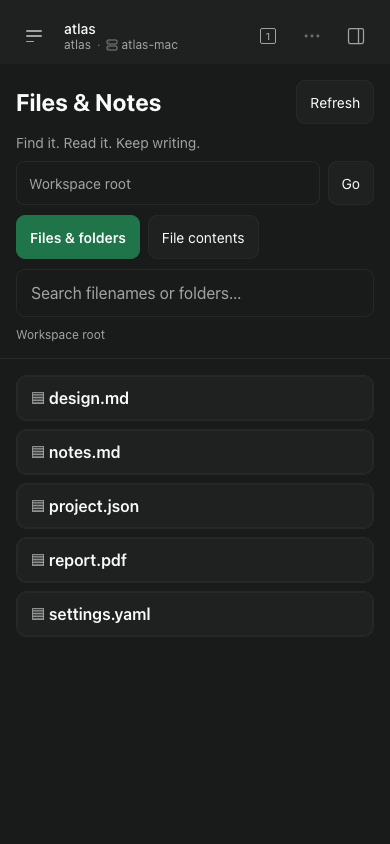
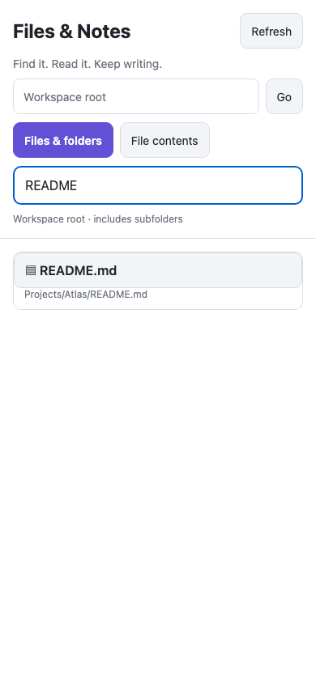
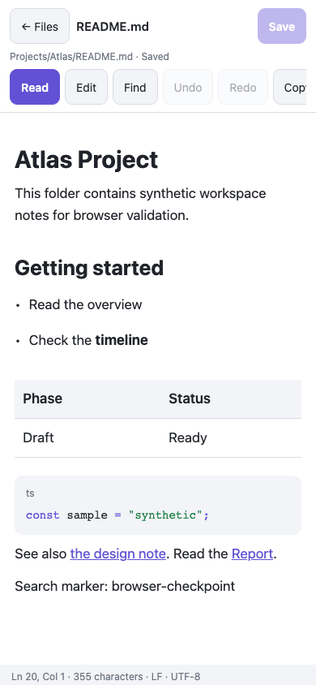
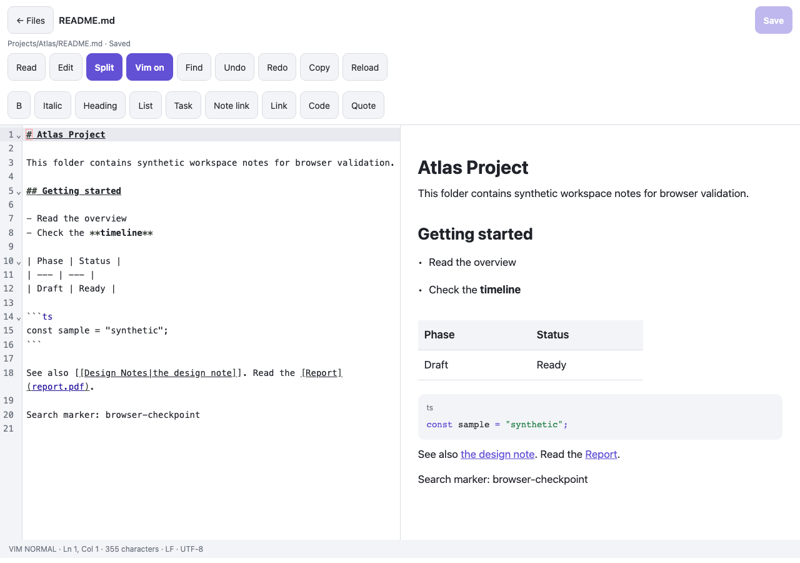

# Files & Notes for Paseo

Find, read and edit your workspace's files and notes, and open PDFs, from Paseo on your phone or desktop.

```sh
paseo plugin add npm:@kevlai22/paseo-files
```

On the Paseo plugin directory: [paseo.sh/plugins/kevguy/files](https://paseo.sh/plugins/kevguy/files)

<p>
  
</p>

<sub>Recorded in Paseo's web app at a phone's screen size, with the fictional Atlas workspace.</sub>

## About

Find a file, read a note, make an edit, or open a PDF without leaving Paseo. Files & Notes brings workspace navigation and a Markdown-first editor to the same interface on phones and desktops.

## What you can do

- **Read Markdown comfortably.** Headings, lists, task lists, tables, quotes, code blocks and YAML properties have a reading view. Follow relative Markdown links and `[[note links]]` inside your workspace.
- **Write from your phone.** Switch to Edit for a formatting toolbar, selection wrapping, undo/redo, Find and explicit Save. Desktop layouts also offer a split reading/editing view.
- **Use Vim on desktop/web.** CodeMirror provides a Vim toggle, modal editing and `:w` saving. The toggle is also available in tablet browsers with a keyboard; native Android/iPad apps use native editing without Vim. Desktop Paseo uses the web editor too.
- **Edit source files.** Open UTF-8 code, JSON, YAML, configuration and plain-text files. Syntax view highlights common languages; JSON has a format action. Edits stay local to the selected host.
- **Read PDFs.** Open a PDF straight from search, browse pages, zoom, search extracted text and copy text. Rendering happens on the host, so the native phone client receives page images rather than relying on an Android browser PDF viewer.
- **Get to files quickly.** Search file and folder names, search literal text inside files, browse directories, or enter a workspace-relative folder path. Search uses ripgrep when available and a bounded fallback otherwise.

Use it to review a project plan on the train, correct a YAML setting, find the note containing a phrase you remember, or read the PDF report an agent just created.

## A look inside

Screenshots use an entirely fictional Atlas workspace. These are the real components in a browser harness at desktop and narrow screen sizes, not native-device screenshots.

<p>
  
  
</p>



## Install from npm

With Paseo 0.16.2 or later, install the exact published release on the host:

```sh
paseo plugin install npm:@kevlai22/paseo-files@0.1.4
paseo plugin ls paseo-files
```

Keep the host online while Paseo downloads and prepares the package. Installing a plugin does not restart the daemon. Repeat on each host where you want to use it.

## Install

Requires Paseo **0.16.1 or later** and npm on the daemon host. Plugins must already be enabled in Paseo. Each installation serves the plugin to that host's connected phone and desktop clients.

From a source checkout:

```sh
npm ci --ignore-scripts
paseo plugin install /absolute/path/to/paseo-files
```

Or unpack a release archive into a permanent directory and install that directory. The manifest installs locked runtime and compiler type dependencies with lifecycle scripts disabled. Install separately on each host where you want to use it. No daemon restart is required to add this plugin to an already enabled plugin runtime.

## Faster search with ripgrep (optional)

Search works without any extra software: if [ripgrep](https://github.com/BurntSushi/ripgrep) (`rg`) is not on the daemon's `PATH`, or cannot be started, Files & Notes uses its built-in search instead. That fallback is bounded, so on large workspaces it may stop early and label the results as limited. Installing ripgrep on the daemon host makes search faster and lets it cover more files. The plugin does not bundle ripgrep, and it ignores your personal ripgrep config file.

| Host | Install |
| --- | --- |
| macOS | `brew install ripgrep` |
| Debian / Ubuntu | `sudo apt install ripgrep` |
| Fedora | `sudo dnf install ripgrep` |
| Arch | `sudo pacman -S ripgrep` |
| Windows | `winget install BurntSushi.ripgrep.MSVC` (or `choco install ripgrep`, `scoop install ripgrep`) |

Check with `rg --version` in a new terminal. The daemon only sees programs on the `PATH` it was started with, so restart Paseo after installing. A shell alias or function named `rg` (for example the one Claude Code adds to your shell) is not visible to the daemon.

## Using it

Open **Files & Notes** in the sidebar and select a workspace. You can also open its workspace/Explorer panel or use **Find files and notes** in the Command Center. Existing text file tabs offer **Notes & Code**; PDF file tabs offer **Viewer**.

The [fictional Atlas workspace](examples/atlas/notes.md) includes linked Markdown notes, YAML, JSON and a three-page PDF. Open a workspace containing this checkout and browse to `examples/atlas` to try the flow without editing your own documents.

For development updates in the same registered directory:

```sh
paseo plugin reload paseo-files
```

## Saving and drafts

Save is explicit. A file whose contents changed since it was opened is rejected instead of being silently overwritten. Copy your draft or reload and merge the latest file. There is no force-overwrite button.

The workspace tab shows an unsaved marker for Paseo’s close handling; returning to the file list asks before discarding edits. Drafts are kept in the tab's persisted state and in client memory while navigating. This means the connected client stores copies of text you edit, under Paseo's normal client storage. A plugin reload, app crash or client-storage reset is not a substitute for saving.

Writes use an atomic replacement in the same directory, preserve ordinary permission bits and check the saved revision. Concurrent writers that do not share this plugin's lock can still race in the small interval between the final check and replacement. Avoid editing the same file simultaneously with an automated writer.

## Boundaries and practical limits

- Only files inside the selected Paseo workspace are available. Text operations reject symbolic-link traversal, special files, invalid UTF-8 and files larger than 512 KiB. No arbitrary shell command is exposed.
- Search is literal and case-insensitive in the interface. Content results show the first matching line per file. Results, scan time and output are bounded; a limited result set is labelled so it is not mistaken for a complete search. Dependency/build directories are skipped. Search does not keep a background content index.
- Native source editing uses the platform text input with editing tools; highlighting is in Syntax/Read mode. Desktop and browser editing uses CodeMirror with inline highlighting and optional Vim bindings. LSP completions, an Obsidian plugin ecosystem and a knowledge graph are outside this release.
- Internal links can open files in the workspace. Wiki links that need disambiguation open a filename search. Heading-only links provide a Find hint. Images in Markdown are links to the integrated viewer; remote content and HTML scripts are never loaded by the Markdown reader.
- PDF search needs a text layer; scanned images do not gain OCR. Host rendering consumes host resources while a document is open. Password-protected PDF handling is inherited from the document viewer.
- Document positions and marks are stored under `~/.local/state/paseo-files/doc-viewer` (or `XDG_STATE_HOME/paseo-files/doc-viewer`). `PASEO_FILES_DOC_VIEWER_STATE_DIR` can select an absolute directory. This is separate from a standalone PDF/Office viewer installation. File contents and review drafts may also be cached on the client.
- The integrated viewer includes Office and image readers from upstream. PDF is the primary validation target here; support for other formats follows that project's documented limits.

## Existing plugins and reuse

This project concentrates on the combined phone workflow, rather than claiming to replace every editor:

| Plugin | Documented strength | Why Files & Notes exists alongside it |
|---|---|---|
| [Editor Plus](https://paseo.sh/plugins/bendavid/editor-plus) | Desktop/web CodeMirror and language tooling | Our editing interface also runs in the native phone app. |
| [Find in Files](https://paseo.sh/plugins/po-trottier/find-in-files) | Indexed content search and in-place text editing | We combine file/folder navigation, Markdown reading/editing and direct PDF opening. |
| [PDF and Office viewer](https://github.com/nkwib/paseo-doc-viewer) | Native-compatible document rendering, text search and page navigation | We reuse its MIT-licensed viewer code rather than rebuilding it. |

The document viewer is pinned to upstream commit `5b7cee29d7e9d57505b9e435bdf7af0a78a126ff` (v0.8.0). Attribution, its license and notices are in [THIRD_PARTY_NOTICES.md](THIRD_PARTY_NOTICES.md) and `vendor/doc-viewer/`. Integration changes are recorded in [LOCAL_CHANGES.md](vendor/doc-viewer/LOCAL_CHANGES.md). This integration does not subscribe to agent turns or automatically send document cards.

## Development and verification

```sh
npm ci --ignore-scripts
npm run typecheck
npm test
```

CI runs the type check and tests on macOS, Linux and Windows, each with ripgrep installed and with ripgrep absent. Tests create synthetic fixtures under `.validation/`. To exercise the actual editing/search components with synthetic files:

```sh
npx playwright install chromium
node --import tsx tests/browser/run.ts
node --import tsx tests/pdf-integration.mts
```

The harness serves only loopback HTTP, stops its browser/server on completion, and saves a report and screenshots under `.validation/browser/`. The browser harness uses a document-viewer stub to check navigation; the separate PDF integration check builds the real server contribution and opens/renders a generated three-page fictional report. Its narrow React Native Web layout is a proxy, not an Android device test. Physical-phone keyboard, clipboard and reconnect behavior require separate evidence.

MIT licensed. No accounts, cloud service, analytics or background indexing are required.
